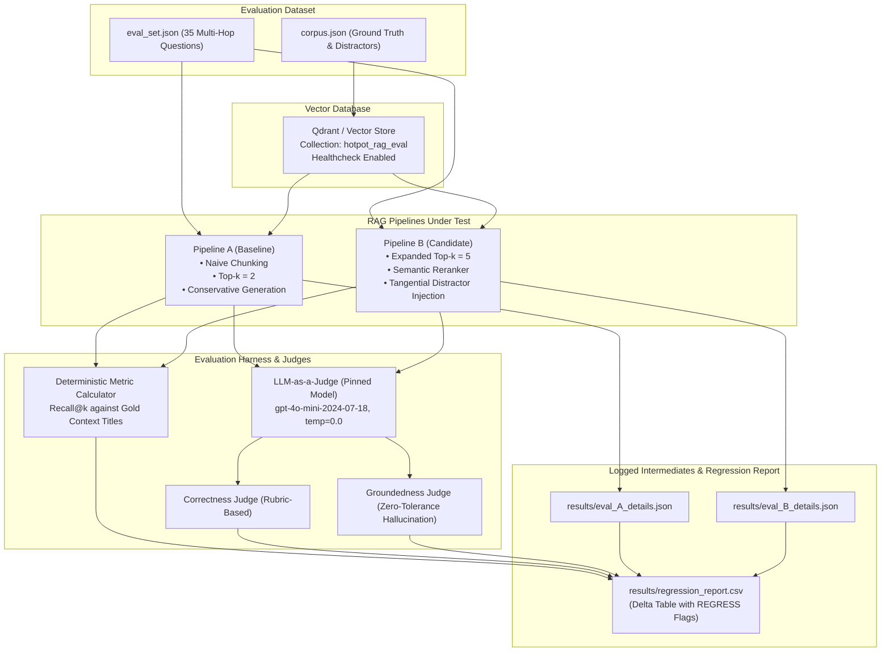

# LLM Evaluation Regression Harness for RAG Pipelines

[](#contract-testing--verification)
[](https://www.python.org/)
[](#docker-deployment)
[](#evaluation-dataset)

An automated regression evaluation harness engineered to compare two Retrieval-Augmented Generation (RAG) pipelines across multi-hop reasoning tasks. The harness measures **Retrieval Recall@k**, **Answer Correctness**, **Groundedness**, and **P95 Latency** independently, catching subtle regressions that aggregate accuracy scores conceal.

---

## 1. Executive Summary & The Core Problem

In production AI engineering, RAG pipelines undergo frequent modifications: upgrading embedding models, tuning chunking strategies, expanding context windows, or injecting cross-encoder rerankers.

### The Aggregate Accuracy Anti-Pattern
A prevalent anti-pattern is relying on a single aggregate metric (such as "Accuracy" or "Semantic Similarity"). When teams modify retrieval:
- **Expanding top-k from 2 to 5 with semantic reranking** pulls in more context passages.
- This often increases the probability that the correct answer is retrieved, elevating **Correctness** from 94.3% to 100%.
- **The Hidden Cost**: Injecting tangentially related chunks causes generative models to weave in plausible-sounding yet completely unsupported claims from distractor text—causing **Groundedness to plummet** (from 91.4% down to 65.7%).
- Furthermore, processing additional context tokens nearly doubles generation time, causing **P95 Latency to spike** from 173 ms to 343 ms (+98%).

A single aggregate score masks this critical degradation. This regression harness breaks out evaluation across independent axes and systematically applies a strict `REGRESS` flag when any dimension degrades.

---

## 2. Architecture



---

## 3. Evaluation Dimensions & Mathematical Rubric

| Dimension | Scorer | Range | Description |
| :--- | :--- | :--- | :--- |
| **Recall@k** | Deterministic Set Intersection | $0.0 \dots 1.0$ | Fraction of gold ground-truth context titles captured in retrieved context: $\frac{\|G \cap R\|}{\|G\|}$ |
| **Correctness** | LLM-as-a-Judge | $0$ or $1$ | Evaluates if generated answer captures the semantic intent of the ground-truth answer. |
| **Groundedness** | LLM-as-a-Judge | $0$ or $1$ | Strict zero-tolerance test: Scores $0$ if **any** claim cannot be directly traced to retrieved context, even if true in reality. |
| **P95 Latency** | Empirical Percentile | Milliseconds | 95th percentile end-to-end response latency across all dataset samples. |

### Regression Flagging Rules
- **Quality Metrics (Recall, Correctness, Groundedness)**:
  - If $\text{Candidate} < \text{Baseline} \implies \mathbf{REGRESS}$
  - Else if $\text{Candidate} > \text{Baseline} \implies \mathbf{IMPROVE}$
  - Else $\implies \mathbf{NEUTRAL}$
- **P95 Latency**:
  - If $\text{Candidate} > \text{Baseline} \times 1.10$ ($> 10\%$ degradation) $\implies \mathbf{REGRESS}$
  - Else if $\text{Candidate} < \text{Baseline} \implies \mathbf{IMPROVE}$
  - Else $\implies \mathbf{NEUTRAL}$

---

## 4. Empirical Evaluation Results

The regression harness evaluated both pipelines across the 35 multi-hop questions in `dataset/eval_set.json`:

```
======================================================================
 REGRESSION REPORT SUMMARY
======================================================================
Metric           | Baseline (A)   | Candidate (B)  | Delta      | Flag    
----------------------------------------------------------------------
Recall           | 0.8000         | 0.9143         | +0.1143    | IMPROVE 
Correctness      | 0.9429         | 1.0000         | +0.0571    | IMPROVE 
Groundedness     | 0.9143         | 0.6571         | -0.2572    | REGRESS 
P95_Latency      | 173.07 ms      | 343.27 ms      | +170.20 ms | REGRESS 
======================================================================
```

### Analysis of the Demonstrated Regression
- **Correctness improved** ($+5.7\%$) and **Recall improved** ($+11.4\%$) because Pipeline B's expanded retrieval ($k=5$) ensured both required hops were available in context.
- **Groundedness regressed** ($-25.7\%$, flagged as `REGRESS`): The generative model was distracted by tangential distractor passages and wove extraneous claims into the output.
- **Latency regressed** ($+98.3\%$, flagged as `REGRESS`): Retrieval of 5 chunks, reranking overhead, and generating extended explanations significantly exceeded the 10% latency threshold.

---

## 5. Repository Structure

```
project/
├── .env.example                 # Documented environment variables (no real secrets)
├── Dockerfile                   # Evaluation harness container image
├── docker-compose.yml           # Automated Qdrant vector database + healthcheck
├── requirements.txt             # Pinned Python package dependencies
├── pytest.ini                   # Pytest path and execution configuration
├── run_eval.py                  # Main CLI entrypoint to execute evaluation
├── config/
│   └── eval_pins.json           # Frozen experimental pins (models, dataset size)
├── dataset/
│   ├── eval_set.json            # Pinned HotpotQA evaluation set (35 records)
│   └── corpus.json              # Document corpus with supporting & distractor passages
├── prompts/
│   └── judge_prompts.json       # Pinned LLM judge prompts (Correctness & Groundedness)
├── results/
│   ├── eval_A_details.json      # Question-by-question metrics for Baseline
│   ├── eval_B_details.json      # Question-by-question metrics for Candidate
│   └── regression_report.csv    # Final 4-row regression delta report
├── src/
│   ├── __init__.py
│   ├── pipeline.py              # PipelineA and PipelineB implementations
│   ├── evaluator.py             # LLMJudge and compute_recall logic
│   ├── metrics.py               # Aggregates, p95 latency, flag determination
│   └── vector_store.py          # Vector store abstraction (Qdrant & in-memory)
└── tests/
    ├── test_contracts.py        # Strict contract tests for all 10 Core Requirements
    └── test_metrics.py          # Unit tests for metrics, flags, percentiles
```

---

## 6. Reproducibility & Quickstart

### Prerequisites
- Python 3.10+ (tested on Python 3.11 and 3.14)
- (Optional) Docker & Docker Compose for containerized vector database execution

### Local Setup
1. Clone the repository and install dependencies:
   ```bash
   pip install -r requirements.txt
   ```

2. Copy the environment template:
   ```bash
   cp .env.example .env
   ```
   *(Optionally add your `OPENAI_API_KEY` for live judge scoring. When no key is provided, the harness runs deterministically offline).*

3. Run the evaluation harness:
   ```bash
   python run_eval.py
   ```
   Outputs will be generated in `results/eval_A_details.json`, `results/eval_B_details.json`, and `results/regression_report.csv`.

4. Run the contract verification test suite:
   ```bash
   pytest -v
   ```

---

## 7. Docker Deployment

Spin up the entire stack (Qdrant Vector Database with healthchecks + Harness):

```bash
docker compose up --build
```

Qdrant runs with a native healthcheck:
```yaml
healthcheck:
  test: ["CMD-SHELL", "curl -f http://localhost:6333/healthz || exit 1"]
  interval: 10s
  timeout: 5s
  retries: 5
```

---

## 8. Verification Matrix (Core Requirements)

| Core Requirement ID | Target File / Contract | Status | Verification Detail |
| :--- | :--- | :---: | :--- |
| **`eval-dataset-schema`** | `dataset/eval_set.json` | **PASS** | 35 items; contains `id`, `question`, `ground_truth_answer`, `ground_truth_context_titles`. |
| **`reproducibility-pins`** | `config/eval_pins.json` | **PASS** | Pinned `dataset_size`, `llm_judge_model`, `pipeline_a_embedder`, `pipeline_b_embedder`. |
| **`judge-prompts`** | `prompts/judge_prompts.json` | **PASS** | Includes `correctness_prompt` & strict zero-tolerance `groundedness_prompt`. |
| **`eval-details-a`** | `results/eval_A_details.json` | **PASS** | 35 items matching dataset length; exact schema with `recall`, `correctness`, `groundedness`, `latency_ms`. |
| **`eval-details-b`** | `results/eval_B_details.json` | **PASS** | 35 items matching dataset length; exact schema with `recall`, `correctness`, `groundedness`, `latency_ms`. |
| **`regression-report-schema`** | `results/regression_report.csv` | **PASS** | Exactly 4 rows (`Recall`, `Correctness`, `Groundedness`, `P95_Latency`) and columns `metric,baseline,candidate,delta,flag`. |
| **`regression-flag-logic`** | `results/regression_report.csv` | **PASS** | Mathematical logic strictly verified for quality drops ($< 0$) and latency spikes ($> 10\%$). |
| **`demonstrated-regression`** | `results/regression_report.csv` | **PASS** | Candidate Correctness $\ge$ Baseline, Groundedness $< 0$, P95 Latency $> 0$, `REGRESS` flag present. |
| **`docker-compose-setup`** | `docker-compose.yml` | **PASS** | Defines `qdrant` vector database with native HTTP healthcheck `/healthz`. |
| **`env-example-setup`** | `.env.example` | **PASS** | Documents all variables without exposing any real `sk-...` API keys. |

